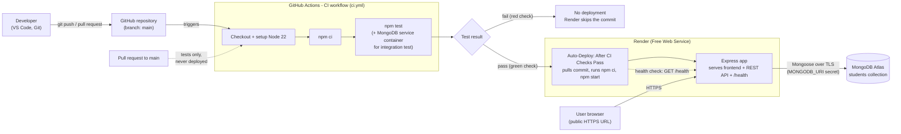
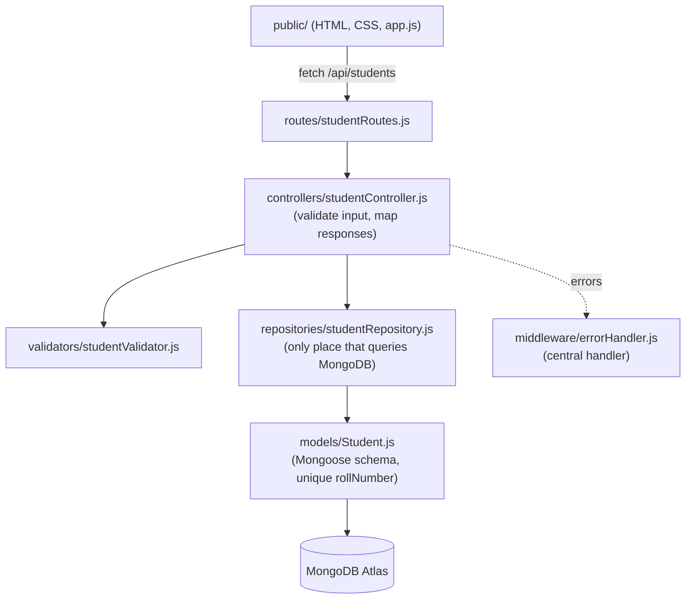

# Architecture

## 1. Pipeline and runtime diagram

This diagram shows the implemented design: GitHub Actions is the CI gate; Render's **Auto-Deploy: After CI Checks Pass** is the only deployment mechanism.

Secrets: `MONGODB_URI` exists only in the Render dashboard (production) and in the developer's local `.env` (git-ignored). CI uses a separate, throw-away MongoDB container and never sees production credentials.

## 2. Application layers

Design choice: the repository layer is the only code that touches MongoDB, so the automated tests can replace it with an in-memory fake (`tests/helpers/fakeRepository.js`) and run without any database or credentials.

## 3. Request flow (create a student)

1. Browser validates the form, then `POST /api/students` with JSON.
2. `requireDatabase` returns 503 if the database is disconnected.
3. Controller validates and normalises the body (strings only, lengths, email, semester 1-8).
4. Repository inserts the document; MongoDB's unique index on `rollNumber` rejects duplicates (error code 11000).
5. The central error handler converts errors to JSON (400/404/409/503/500) without leaking internals; success returns 201.

## 4. Deployment responsibilities

| Concern | Who/what handles it |
|---|---|
| Run tests on every push/PR | GitHub Actions (`ci.yml`) |
| Decide whether to deploy | Render, using the commit's GitHub check results |
| Build and start the app | Render: `npm ci`, then `npm start` |
| HTTPS certificate | Render (automatic) |
| Persistent data | MongoDB Atlas |
| Detecting an unhealthy release | Render health check path `/health` |
